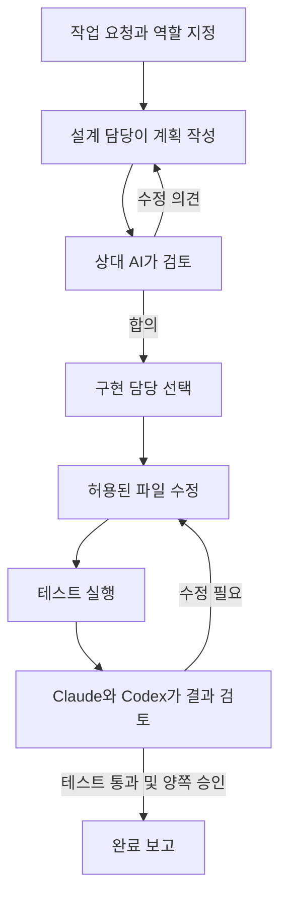

# Claude–Codex 함께 작업하기

**Claude와 Codex가 설계를 논의하고, 사용량에 맞춰 구현을 나눈 뒤, 결과를 서로 검토하는 스킬입니다.**

두 AI의 답변을 사용자가 복사해서 전달할 필요 없이, 한 번의 요청으로 **설계 → 합의 → 구현 → 테스트 → 상호 리뷰**를 진행합니다. Claude 또는 Codex 어느 쪽에서든 시작할 수 있습니다.

[주요 기능](#주요-기능) · [사용 예시](#이렇게-요청하세요) · [설치하기](#설치하기) · [릴리스](https://github.com/kimyoungsik12/claude-codex-discussion/releases/latest)

## 이런 작업에 유용합니다

- 한 AI의 설계를 다른 AI에게 검토받고 싶은데, 매번 답변을 옮겨 붙이기 번거로울 때
- 설계 담당과 구현 담당을 따로 지정하고 싶을 때
- Claude를 주로 사용하면서 남은 사용량에 따라 Codex에도 구현을 맡기고 싶을 때
- 코드 작성뿐 아니라 테스트와 두 AI의 리뷰까지 한 흐름으로 진행하고 싶을 때

## 주요 기능

| 기능 | 동작 | 장점 |
|---|---|---|
| 양방향 시작 | Claude·Codex 어느 쪽에서든 스킬 호출 | 사용하는 AI를 바꾸지 않고 협업 시작 |
| 설계 역할 지정 | 설계 담당을 지정하고 상대 AI가 검토 | 원하는 AI의 설계에 다른 관점을 더함 |
| 자동 의견 교환 | 반대 의견을 설계자에게 전달하고 수정안을 다시 검토 | 사용자가 중간 전달자 역할을 하지 않아도 됨 |
| 사용량 기반 구현 담당 선택 | 기본 Claude, 잔여량 조건에 따라 Codex 선택 | 한쪽 한도가 낮을 때 다른 쪽 여유를 활용 |
| 사용자 지정 우선 | “구현은 Codex”처럼 지정하면 유지 | 중요한 작업에서 담당자를 직접 통제 |
| 구현 후 상호 리뷰 | 실제 테스트 결과와 같은 코드 변경본을 두 AI가 검토 | 작성 후 검토가 빠지는 일을 줄임 |
| 수정 범위 관리 | 지정 파일만 실행기가 반영하고 한 번에 한 작성자만 적용 | 두 AI가 같은 파일을 동시에 덮어쓰는 충돌 방지 |
| 작업 기록 | 제안·이견·선택 이유·테스트·리뷰 결과 저장 | 무엇을 근거로 결정했는지 확인 가능 |

## 어떻게 진행되나요?



논의와 수정에는 횟수 제한이 있습니다. 합의가 안 되거나 필요한 정보가 없으면 이유를 기록하고 멈춥니다. 설계·논의만 요청한 경우 구현하지 않습니다. 테스트 없는 구현은 검증 완료로 처리하지 않습니다.

### 구현 담당은 어떻게 정하나요?

1. **사용자가 지정하면 그 AI가 담당**합니다.
2. 자동 선택의 기본 담당은 **Claude**입니다.
3. 수집한 사용량에서 **Claude 잔여량이 20% 이하이고 Codex가 40% 이상**이면 Codex를 선택합니다.

여러 한도 구간이 있으면 관측된 잔여 비율 중 가장 낮은 값을 사용합니다. 실제 계정 사용량을 기준으로 하며, 컨텍스트 사용률이나 토큰 수를 계정 잔여량으로 대신 계산하지 않습니다. 값이 없거나 오래됐으면 기본 담당을 유지합니다. 담당 전환은 구현 라운드 사이에 적용됩니다.

### 어떤 모델을 사용하나요?

현재 사용자 CLI에 저장된 모델·추론 강도를 읽어 전달합니다. Codex는 `config.toml`의 모델·추론 강도와 선택 프로필, Claude는 `settings.json`의 모델·effort 및 모델/effort 환경변수를 반영합니다. 작업에서 따로 지정하면 그 값이 우선합니다. 설정이 없으면 CLI 기본값을 사용합니다.

**CLI에서도 사용 가능합니다.** Claude Code 터미널에서 `/claude-codex-discussion`, Codex CLI에서 `$claude-codex-discussion`를 호출하세요. 데스크톱 앱은 필수가 아닙니다. 양쪽 CLI가 설치·로그인되어 있어야 합니다.

현재 대화에서만 바꾼 모델이나 프로젝트별 설정, 실행 시 임시로 준 옵션은 자동으로 전달되지 않습니다. 그런 경우 작업 요청에 모델을 명시하세요. 도구·권한·훅 설정은 가져오지 않으며, 실제 전달한 모델·effort는 실행 기록의 `model-settings.json`에 남습니다.

## 이렇게 요청하세요

**설계만 논의하기**

> claude-codex-discussion 스킬로 이 기능을 설계해줘. 설계 담당은 Claude로 하고 Codex와 의견을 교환해 합의해줘. 아직 코드는 수정하지 마.

**설계부터 구현·리뷰까지 맡기기**

> claude-codex-discussion 스킬로 로그인 기능을 설계·합의·구현·테스트·상호 리뷰까지 진행해줘. 설계는 Codex, 구현은 사용량에 따라 자동 선택해줘.

**구현 담당 고정하기**

> claude-codex-discussion 스킬로 이 버그를 해결해줘. 구현은 Codex가 맡고, Claude와 설계 및 수정 결과를 서로 검토해줘.

## 설치하기

Windows·macOS·Ubuntu에서 **Node.js 22 이상**, 최신 Claude Code·Codex CLI와 각 계정 로그인이 필요합니다. Python은 필요 없습니다.

```sh
npx @youngsik1/claude-codex-discussion@latest install
npx @youngsik1/claude-codex-discussion@latest doctor
```

AI에게 아래 링크만 주어 설치를 맡길 수도 있습니다. 계정 로그인은 본인이 진행하세요.

> https://github.com/kimyoungsik12/claude-codex-discussion 의 AI_INSTALL.md를 읽고 내 환경에 설치·확인해줘.

설치 후 새 AI 세션에서 Codex는 `$claude-codex-discussion`, Claude Code는 `/claude-codex-discussion`으로 호출하세요. 터미널 CLI에서도 동작합니다.

## 원격 서버의 Codex + 내 PC의 Claude

원격 작업은 **원격 계정의 스킬**을 검색합니다. PC에만 설치하면 원격에서 나타나지 않으므로 원격에도 설치하세요.

1. 원격: `npx @youngsik1/claude-codex-discussion@latest install --target codex`
2. 로컬: 아래 명령으로 로그인된 Claude를 SSH로 연결하고 프로세스를 유지합니다.

```sh
npx @youngsik1/claude-codex-discussion@latest connect --ssh devbox --provider claude --remote-cli /home/user/.agents/skills/claude-codex-discussion/dist/cli.cjs
```

로컬에 SSH 서버를 열거나 Claude 로그인 정보를 원격으로 복사하지 않습니다. 원격에서 설계·수정안을 주고받고 **파일 수정·테스트는 원격**에서 실행합니다. `--provider codex`로 반대 구성도 가능합니다. 로컬 PC가 꺼지거나 연결 프로세스가 끝나면 연결도 종료됩니다. 원격 Node 경로 지정 등은 [원격 연결 안내](skill/references/remote.md)를 참고하세요. 현재 원격 대상은 Linux/macOS 등 POSIX SSH 호스트이며, 로컬은 Windows·macOS·Linux를 지원합니다.

## 진단·업데이트·제거

- `doctor`: 필요한 CLI 옵션 지원 확인. 로그인·실제 모델 호출 성공은 별도입니다. 오래된 CLI는 최신 모델을 거부할 수 있습니다.
- `models`: 이번 실행에 전달할 저장된 모델·effort 확인.
- `usage`: Codex 한도 갱신 및 Claude가 마지막으로 보고한 한도 확인. Claude 호출 없이 새 Claude 관측을 만들지는 않습니다.
- 업데이트: 협업 실행이 끝난 뒤 설치 명령을 다시 실행합니다. 기존 스킬은 설정 폴더의 `skill-backups`에 보존됩니다.
- 새 Codex 설치 위치: `~/.agents/skills/claude-codex-discussion`, `~/.claude/skills/claude-codex-discussion`. CODEX_HOME / CLAUDE_CONFIG_DIR도 지원합니다.
- 이전 v1 Python 상태줄이 연결되어 있으면 그 연결만 Node 실행기로 이전하고 원래 상태줄 전달 설정을 유지합니다. 모델·로그인 설정은 변경하지 않습니다.
- 제거: 스킬이 상태줄에 연결되어 있다면 백업을 참고해 해당 statusLine 설정만 복구한 뒤 스킬 폴더를 제거하세요. 로그·백업은 자동 삭제하지 않습니다.
- Windows와 WSL은 별도 환경입니다. AI를 실행하는 쪽에 설치·로그인하세요.

직접 실행: `npx @youngsik1/claude-codex-discussion run --config /absolute/task.json`. [작업 설정](skill/references/config.md)을 참고하세요.

## 알아둘 점

현재 열린 대화 대신 독립 CLI 호출로 협업합니다. 선택한 소스는 두 서비스로 전송되므로 비밀 파일을 제외하세요. 실행 로그는 `~/.codex/discussions`에 보관되며 공유하지 마세요. 배포 패키지에는 계정·대화·사용량 캐시가 포함되지 않습니다.

사용량은 실제 CLI 이벤트에서 수집하며 없거나 오래되면 추정하지 않습니다. 양쪽 서비스가 응답해야 상호 리뷰까지 끝낼 수 있습니다. 파일별 원자적 쓰기와 제한된 재시도를 제공하며, 무한 작업이나 중단 후 자동 재개는 아닙니다.

[검증 범위](TESTING.md) · [CI](https://github.com/kimyoungsik12/claude-codex-discussion/actions) · [npm](https://www.npmjs.com/package/@youngsik1/claude-codex-discussion)
