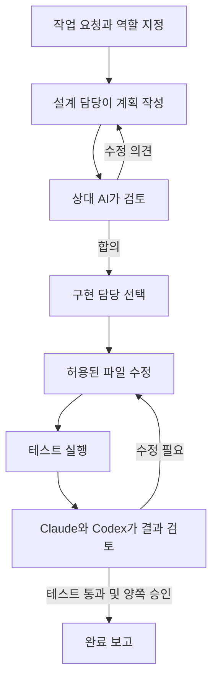

# Claude–Codex 함께 작업하기

**Claude와 Codex가 설계를 논의하고, 사용량에 맞춰 구현을 나눈 뒤, 결과를 서로 검토하는 스킬입니다.**

두 AI의 답변을 사용자가 복사해서 전달할 필요 없이, 한 번의 요청으로 **설계 → 합의 → 구현 → 테스트 → 상호 리뷰**를 진행합니다. Claude 또는 Codex 어느 쪽에서든 시작할 수 있습니다.

[주요 기능](#주요-기능) · [사용 예시](#이렇게-요청하세요) · [설치하기](#설치하기) · [배포 ZIP](https://github.com/kimyoungsik12/claude-codex-discussion/releases/latest)

## 이런 작업에 유용합니다

- 한 AI의 설계를 다른 AI에게 검토받고 싶은데, 매번 답변을 옮겨 붙이기 번거로울 때
- 설계 담당과 구현 담당을 따로 지정하고 싶을 때
- Claude를 주로 사용하면서 남은 사용량에 따라 Codex에도 구현을 맡기고 싶을 때
- 코드 작성뿐 아니라 테스트와 두 AI의 리뷰까지 한 흐름으로 진행하고 싶을 때

## 주요 기능

| 기능 | 동작 | 장점 |
|---|---|---|
| 양방향 시작 | Claude·Codex 어느 쪽에서든 스킬 호출 | 사용하는 AI를 바꾸지 않고 협업 시작 |
| 설계 역할 지정 | 설계 담당을 지정하고 상대 AI가 검토 | 원하는 AI의 설계에 다른 관점을 더함 |
| 자동 의견 교환 | 반대 의견을 설계자에게 전달하고 수정안을 다시 검토 | 사용자가 중간 전달자 역할을 하지 않아도 됨 |
| 사용량 기반 구현 담당 선택 | 기본 Claude, 잔여량 조건에 따라 Codex 선택 | 한쪽 한도가 낮을 때 다른 쪽 여유를 활용 |
| 사용자 지정 우선 | “구현은 Codex”처럼 지정하면 유지 | 중요한 작업에서 담당자를 직접 통제 |
| 구현 후 상호 리뷰 | 실제 테스트 결과와 같은 코드 변경본을 두 AI가 검토 | 작성 후 검토가 빠지는 일을 줄임 |
| 수정 범위 관리 | 지정 파일만 실행기가 반영하고 한 번에 한 작성자만 적용 | 두 AI가 같은 파일을 동시에 덮어쓰는 충돌 방지 |
| 작업 기록 | 제안·이견·선택 이유·테스트·리뷰 결과 저장 | 무엇을 근거로 결정했는지 확인 가능 |

## 어떻게 진행되나요?

논의와 수정에는 횟수 제한이 있습니다. 합의가 안 되거나 필요한 정보가 없으면 이유를 기록하고 멈춥니다. 설계·논의만 요청한 경우 구현하지 않습니다. 테스트 없는 구현은 검증 완료로 처리하지 않습니다.

### 구현 담당은 어떻게 정하나요?

1. **사용자가 지정하면 그 AI가 담당**합니다.
2. 자동 선택의 기본 담당은 **Claude**입니다.
3. 수집한 사용량에서 **Claude 잔여량이 20% 이하이고 Codex가 40% 이상**이면 Codex를 선택합니다.

여러 한도 구간이 있으면 관측된 잔여 비율 중 가장 낮은 값을 사용합니다. 실제 계정 사용량을 기준으로 하며, 컨텍스트 사용률이나 토큰 수를 계정 잔여량으로 대신 계산하지 않습니다. 값이 없거나 오래됐으면 기본 담당을 유지합니다. 담당 전환은 구현 라운드 사이에 적용됩니다.

### 어떤 모델을 사용하나요?

현재 사용자 CLI에 저장된 모델·추론 강도를 읽어 전달합니다. Codex는 `config.toml`의 모델·추론 강도와 선택 프로필, Claude는 `settings.json`의 모델·effort 및 모델/effort 환경변수를 반영합니다. 작업에서 따로 지정하면 그 값이 우선합니다. 설정이 없으면 CLI 기본값을 사용합니다.

**CLI에서도 사용 가능합니다.** Claude Code 터미널에서 `/claude-codex-discussion`, Codex CLI에서 `$claude-codex-discussion`를 호출하세요. 데스크톱 앱은 필수가 아닙니다. 양쪽 CLI가 설치·로그인되어 있어야 합니다.

현재 대화에서만 바꾼 모델이나 프로젝트별 설정, 실행 시 임시로 준 옵션은 자동으로 전달되지 않습니다. 그런 경우 작업 요청에 모델을 명시하세요. 도구·권한·훅 설정은 가져오지 않으며, 실제 전달한 모델·effort는 실행 기록의 `model-settings.json`에 남습니다.

## 이렇게 요청하세요

**설계만 논의하기**

> claude-codex-discussion 스킬로 이 기능을 설계해줘. 설계 담당은 Claude로 하고 Codex와 의견을 교환해 합의해줘. 아직 코드는 수정하지 마.

**설계부터 구현·리뷰까지 맡기기**

> claude-codex-discussion 스킬로 로그인 기능을 설계·합의·구현·테스트·상호 리뷰까지 진행해줘. 설계는 Codex, 구현은 사용량에 따라 자동 선택해줘.

**구현 담당 고정하기**

> claude-codex-discussion 스킬로 이 버그를 해결해줘. 구현은 Codex가 맡고, Claude와 설계 및 수정 결과를 서로 검토해줘.

## 설치하기

파일·터미널을 사용할 수 있는 **Codex 또는 Claude Code**에 아래 한 줄을 전달하세요. AI가 다운로드부터 환경 진단·설치·확인까지 진행합니다. 계정 로그인은 본인이 해야 합니다.

> https://github.com/kimyoungsik12/claude-codex-discussion 의 AI_INSTALL.md를 읽고 내 환경에 설치한 뒤 확인해줘.

일반 웹 채팅처럼 PC의 파일과 터미널에 접근할 수 없는 환경에서는 직접 설치할 수 없습니다. ZIP으로 전달받았다면 압축을 풀고 그 폴더의 `AI_INSTALL.md`를 읽어 설치하도록 요청하면 됩니다.

## 직접 설치

| 환경 | 압축 해제한 폴더에서 실행 |
|---|---|
| Windows | `install.cmd` 더블클릭 또는 터미널에서 `install.cmd install` |
| macOS | `bash install.sh` |
| Ubuntu / WSL Ubuntu | `bash install.sh` |

Python **3.10 이상**, Claude CLI, Codex CLI가 필요합니다. 설치 스크립트는 Python 표준 라이브러리만 사용하며 pip 설치가 필요 없습니다. 관리자 권한 없이 현재 사용자에게 설치합니다. Windows와 WSL은 별개 환경이므로 AI를 실행하는 쪽에 설치하고 로그인하세요.

- Python: https://www.python.org/downloads/ (Windows는 PATH 추가 옵션 확인). Ubuntu 22.04 이상은 `python3 --version`으로 확인하고 없으면 `sudo apt install python3`를 사용자가 실행합니다. 구형 Ubuntu의 Python이 3.10 미만이면 먼저 업그레이드해야 합니다.
- Claude CLI 공식 설치: https://code.claude.com/docs/en/setup
- Codex CLI 공식 설치: https://developers.openai.com/codex/cli
- 각각 `claude`, `codex`를 실행해 본인 계정으로 로그인하세요. 구독/계정 이용 조건과 비용은 각 서비스에 따릅니다. API 키 사용 환경에서는 구독 잔여량이 제공되지 않을 수 있습니다.

설치 후 새 AI 세션을 여세요. 다음 문장으로 시작할 수 있습니다.

> claude-codex-discussion 스킬로 [원하는 작업]을 설계·합의·구현·테스트·상호 리뷰까지 진행해줘. 설계는 Claude, 구현은 자동 선택해줘.

Codex에서는 `$claude-codex-discussion`, Claude에서는 `/claude-codex-discussion`로도 호출할 수 있습니다. 발견되지 않으면 아래 설치 경로의 SKILL.md를 읽도록 요청하세요.

## 진단·업데이트·제거

- Windows: `install.cmd doctor`, macOS/Ubuntu: `bash install.sh doctor`. 명령 지원 여부를 확인하며 로그인이나 실제 모델 호출 성공을 보장하는 검사는 아닙니다.
- 설치 위치: `~/.codex/skills/claude-codex-discussion`, `~/.claude/skills/claude-codex-discussion`. CODEX_HOME / CLAUDE_CONFIG_DIR를 설정한 경우 그 아래 skills를 사용합니다.
- 업데이트: 진행 중인 협업을 마친 뒤 새 ZIP을 풀고 다시 설치합니다. 이전 버전은 각 설정 폴더의 `skill-backups`에 보존됩니다. 기존 settings.json·상태줄·로그인은 변경하지 않습니다.
- 제거: 위의 **해당 스킬 폴더만** 제거하세요. 로그·백업은 자동 삭제하지 않습니다. 별도로 상태줄을 연결했다면 먼저 그 스킬의 `scripts/usage.py uninstall`로 복구하세요.
- 상세 역할/설정: `skill/SKILL.md`, `skill/references/config.md`. 모델 버전·실행 제한과 파일 범위를 지정할 수 있습니다.

## 알아둘 점

현재 열린 채팅에 메시지를 주고받는 방식이 아니라 독립 CLI 호출로 협업합니다. 선택한 소스 코드는 두 서비스로 전송되므로 비밀 파일을 포함하지 마세요. 로그는 `~/.codex/discussions`에 남으며 다른 사람에게 배포하지 마세요. 이 ZIP에는 계정·프로젝트·사용량 캐시·개인 대화 기록이 들어 있지 않습니다.

사용량은 실제 CLI 이벤트에서 수집하며 오래되거나 없으면 추정하지 않습니다. 전환은 작업 라운드 사이에서 이뤄집니다. 양쪽 서비스가 응답할 수 있어야 상호 리뷰까지 완료할 수 있습니다. 파일당 원자적 쓰기, 제한된 재시도이며 무한 자동 작업·중단 후 자동 재개는 아닙니다.

Windows·macOS·Ubuntu의 GitHub Actions에서 설치 및 실행기 단위 테스트가 통과했습니다. 실제 계정으로 모델 호출과 자동 전환까지 확인한 환경은 Windows입니다. [CI 결과](https://github.com/kimyoungsik12/claude-codex-discussion/actions/runs/38518702310)와 [상세 검증 범위](TESTING.md)를 참고하세요.
